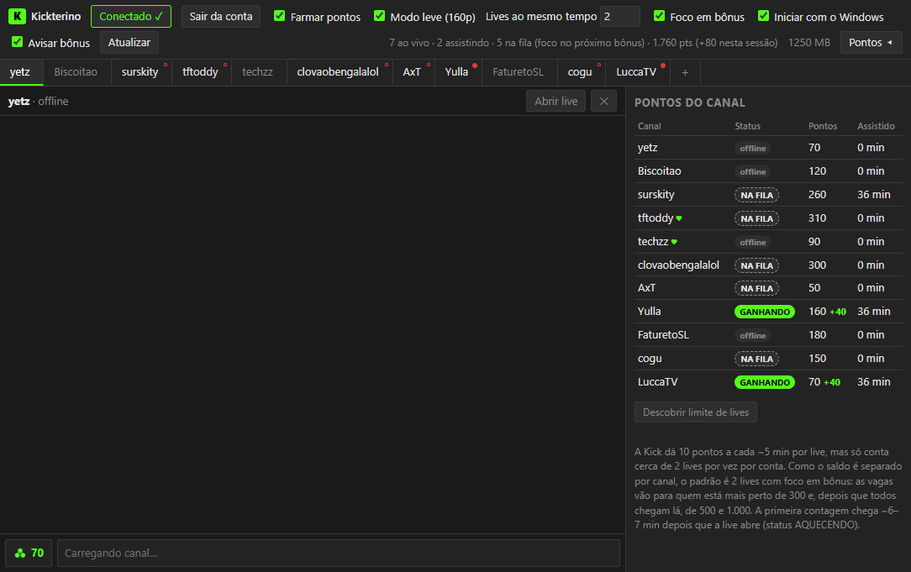

# Kickterino

Cliente de chat para a Kick no estilo do [Chatterino](https://chatterino.com/), feito para a comunidade do PokeIdle. Ele mantém 2 lives em segundo plano, com o mínimo de memória e internet, para acumular pontos do canal e comprar bônus.

**[Baixar para Windows](https://viinnisantoos.github.io/kickterino/)**



## Recursos

- **Chat em abas** de vários canais, com envio de mensagens e aviso de resgates.
- **Painel de pontos** com saldo, status e ganho de cada canal.
- **Foco em bônus:** as vagas vão para os canais mais perto de 300 pontos, depois 500, 1.000 e cada milhar seguinte.
- **Modo leve:** lives ocultas em 160p, sem som, sem imagens e sem anúncios.
- **Modo 24/7:** fica na bandeja, inicia com o Windows e se recupera de quedas e de suspensão.
- **Avisos de bônus** quando um canal alcança 300, 500 ou 1.000 pontos.
- **Atualização automática** pelo GitHub Releases.

## Como funciona

O app é feito em Electron e não tem servidor próprio.

- Cada live é a página real da Kick, aberta numa janela invisível e sem som.
- Uma janela oculta em `kick.com` consulta status e saldo, usando a sessão da própria pessoa.
- O protocolo DevTools limita a live à menor qualidade e lê o chat da conexão em tempo real que a página da Kick já abre.
- A cada minuto, o app confere o estado dos canais e reorganiza as vagas.

## O que os testes mostraram

- A Kick conta cerca de 2 lives por vez por conta. Com 2, 3, 4 ou 10 lives abertas, o ganho total foi o mesmo.
- O limite vale entre aparelhos: celular e TV disputam as mesmas 2 vagas com o app.
- A primeira contagem leva cerca de 6–7 min depois que a live abre. Depois, são +10 a cada ~5–6 min, ou cerca de 220 pontos por hora.
- O painel tem um **teste de limite**, que refaz essa medição na sua conta.

## Segurança da conta

- O login é feito na própria página da Kick, Google, Apple ou Discord. O app não lê nem guarda a senha.
- Não há servidor do Kickterino: a sessão fica só no seu PC, com os cookies criptografados pelo Windows.
- Só a Kick e as páginas de login abrem dentro do app. Outros sites são bloqueados, e nenhuma página acessa câmera, microfone ou localização.
- **Sair da conta** apaga do app todos os dados de login, mantendo a lista de canais e as preferências.
- Baixe só do site ou dos Releases deste repositório, e nunca envie a pasta de dados do app para ninguém.

## Desenvolvimento

Requer Node.js.

```bash
npm install
npm start
```

Para gerar o instalador e a versão portátil em `dist/`:

```bash
npm run dist
```

## Limitações

- Funciona só no Windows.
- O saldo e o envio de mensagens usam endpoints internos da Kick, que podem mudar sem aviso.
- O chat só aparece nos canais que estão sendo assistidos.
- O app ainda não tem assinatura digital, então o Windows pode exibir um aviso na instalação.
- Projeto independente, sem ligação com a Kick ou o PokeIdle. Assistir sem estar presente pode ir contra os termos de uso da Kick; use por sua conta e risco.

## Licença

[MIT](LICENSE)
